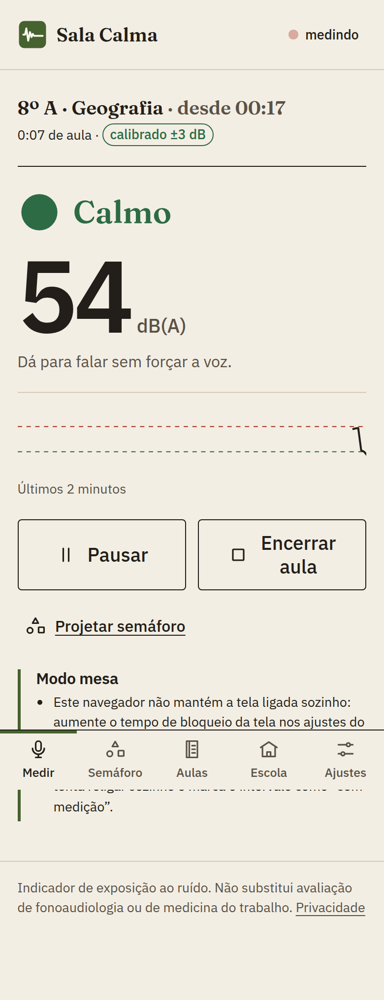
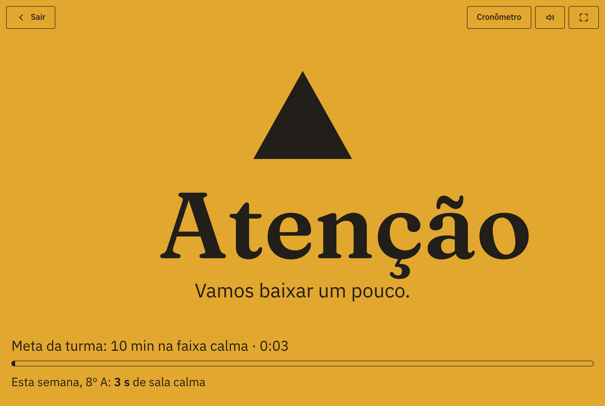
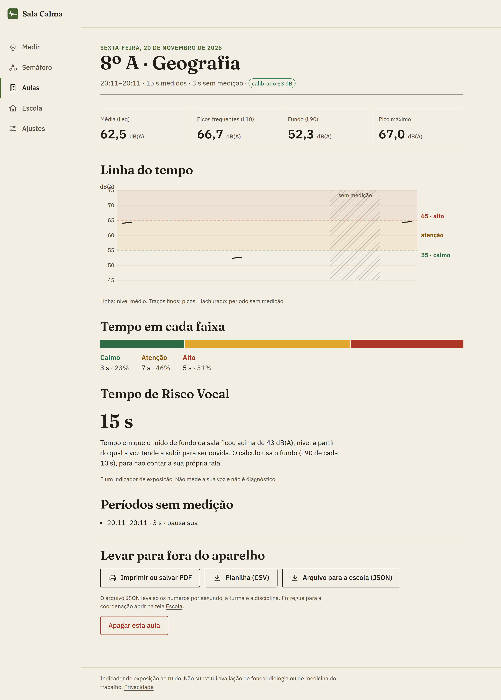
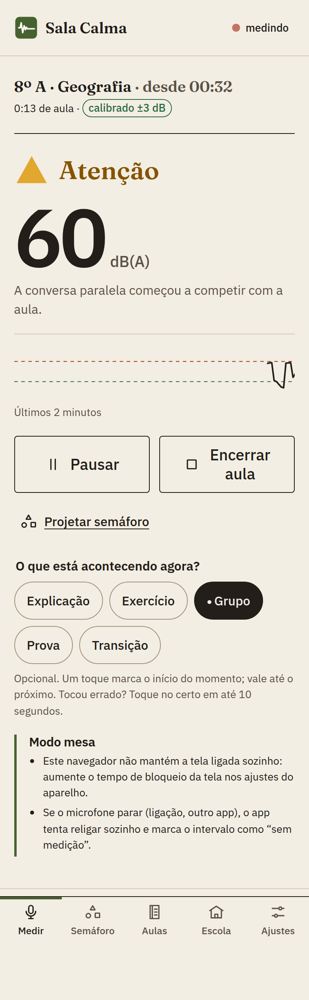
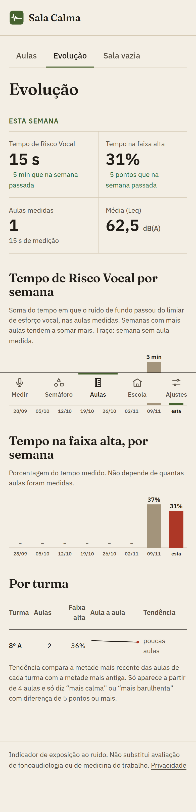
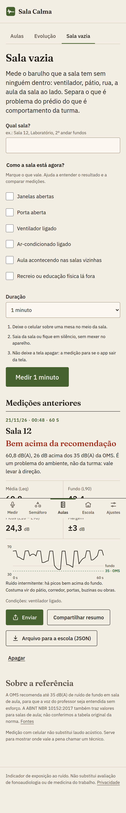

# Sala Calma

Medidor de ruído para a sala de aula. Usa o microfone do celular, **não grava nem envia áudio**, mostra um semáforo que a turma entende e gera relatórios para o professor e para a escola.

- **Site:** https://sala-calma.vercel.app (plano B: https://jkfa.github.io/sala-calma/)
- PWA gratuito, funciona offline, instala em Android, iPhone e computador.
- Sem backend, sem conta, sem analytics. Tudo fica no aparelho.

| Medição ao vivo | Semáforo (projetar) | Relatório da aula |
| --- | --- | --- |
|  |  |  |

| Momentos da aula | Evolução | Sala vazia |
| --- | --- | --- |
|  |  |  |

> As capturas vêm do teste automático, com um som de sala sintético. Não são medições reais.

## O que faz

1. **Mede a aula inteira.** Nível a cada 125 ms, ponderação A, em dB(A) quando o aparelho está calibrado. Modo mesa: mantém a tela ligada (Wake Lock), avisa bateria baixa, religa o microfone sozinho e marca os intervalos sem medição na linha do tempo.
2. **Semáforo em tela cheia.** Calmo / Atenção / Alto, com cor, **forma** (círculo, triângulo, quadrado) e palavra. Meta da turma (“10 minutos na faixa calma”) que só soma, nunca desconta. Toque suave opcional ao cumprir a meta; dá para silenciar.
3. **Relatório da aula.** Leq, L10, L90, pico, linha do tempo, tempo em cada faixa, **Tempo de Risco Vocal** e períodos sem medição. Exporta PDF (impressão), CSV e JSON.
4. **Momentos da aula.** Durante a medição, botões “Explicação”, “Exercício”, “Grupo”, “Prova” e “Transição” marcam o que está acontecendo; cada marcação vale até a próxima. Tocou errado? Toque no certo em até 10 s e a marcação é corrigida. O relatório mostra a faixa de momentos sob a linha do tempo, uma tabela por momento (tempo, % na faixa alta, média, Risco Vocal) e destaca o mais barulhento (só com 2+ momentos de 2 min ou mais). CSV e JSON levam os momentos; o painel da escola soma por tipo de atividade.
5. **Evolução.** Semana a semana (últimas 8): Tempo de Risco Vocal somado e % do tempo na faixa alta, comparando com a semana anterior. Por turma: aula a aula e tendência (“mais calma”, “estável”, “mais barulhenta”), só afirmada com 4+ aulas e diferença de 5 pontos ou mais.
6. **Sala vazia.** Medição de 1 ou 2 minutos sem a turma, com as condições anotadas (janelas, ventilador, recreio…). Compara o Leq com os 35 dB(A) da OMS **considerando a margem de erro** (se a diferença cabe na margem, o app diz que não dá para afirmar) e indica se o ruído é constante (ventilador, ar) ou intermitente (pátio, corredor). Separa problema do prédio de comportamento da turma.
7. **Painel da escola, sem servidor.** A coordenação abre vários JSON exportados (aulas e salas vazias) e vê, por turma, dia e horário, onde a acústica pesa mais, além da tabela de salas vazias acima da recomendação. Imprime relatório para direção, CIPA ou Regional.

## O que não faz

- Não grava áudio, nem temporariamente. O AudioWorklet calcula a energia de cada janela e envia só três números para a página (média quadrática ponderada A, sem ponderação e pico).
- Não envia dados. Não há `fetch`, `XMLHttpRequest`, `sendBeacon`, WebSocket nem scripts de terceiros (há teste para isso).
- Não é sonômetro profissional e não faz diagnóstico. É um indicador de exposição.

## Como rodar

```bash
npm install
npm run dev          # http://localhost:5173 (localhost conta como seguro para o microfone)
npm test             # testes unitários (Vitest)
npm run build        # gera dist/
npm run test:e2e     # e2e no Chrome com microfone falso (precisa do build)
SHOTS=1 npm run test:e2e   # idem, salvando screenshots em docs/screenshots
```

O e2e usa o Chrome do sistema (`/usr/bin/google-chrome`); para outro caminho, defina `CHROME=/caminho/do/chrome`.

Para trocar o nome do app, mude `src/config.ts` (o manifest e o `<title>` leem de lá).

## Como calibrar

Sem calibração o app mostra só **faixas relativas** e avisa isso na tela. Para ver dB(A):

1. Ajustes › Calibração (ou tela **Calibrar**).
2. **Com medidor de referência** (recomendado, margem estimada ±3 dB): coloque o celular ao lado de um decibelímetro em dBA/slow, com um som constante no ambiente, digite o valor lido e toque em “Medir 10 segundos”.
3. **Sem medidor** (margem ±8 dB): numa sala vazia e silenciosa, o app assume 35 dB(A).

A calibração fica salva no aparelho com a data, e pode ser refeita ou removida. Ela vale para aquele aparelho e navegador.

## Como funciona a medição

- `getUserMedia` com `echoCancellation`, `noiseSuppression` e `autoGainControl` desligados.
- Ponderação A (IEC 61672) por três biquads, obtidos pela transformada bilinear do filtro analógico e normalizados em 1 kHz. Erro menor que 0,5 dB de 31,5 Hz a 4 kHz; perto de Nyquist a resposta achata (testado em `tests/aweighting.test.ts`).
- AudioWorklet (`src/audio/level-processor.js`); fallback com `IIRFilterNode` + `AnalyserNode` em navegadores sem worklet.
- dBFS convencional AES17; dB(A) = dBFS(A) + ajuste de calibração.
- **Leq** = média energética. **L10** = nível superado em 10% do tempo. **L90** = superado em 90% (ruído de fundo).
- **Tempo de Risco Vocal**: tempo em que o **ruído de fundo** (L90 móvel de 10 s, sem atravessar lacunas) ficou acima do limiar de esforço vocal. Usar o fundo, e não o nível total, evita contar a própria fala do professor.

## Limiares e fontes

| Valor | Uso no app | Fonte | Situação |
| --- | --- | --- | --- |
| 35 dB LAeq | Referência de sala vazia; método “sala silenciosa” | OMS, *Guidelines for Community Noise* (1999), e ficha da OMS/Europa sobre ruído | Confirmado |
| 43 dB(A) de ruído de fundo | Limiar padrão do Tempo de Risco Vocal | Bottalico, Passione, Graetzer, Hunter (2017), *Evaluation of the starting point of the Lombard effect*, Acta Acustica united with Acustica: ponto de virada em 43,3 dB(A) de ruído de fundo (Ln) | Confirmado (resumo do artigo, via Europe PMC) |
| ABNT NBR 10152:2017 | Citada como referência para sala de aula | Fontes secundárias citam RLAeq 35 dB(A) para salas de aula | **A confirmar**: não conferimos a tabela da norma (documento pago) |
| 55 e 65 dB(A) | Limites das faixas calmo/atenção/alto | Nenhuma norma. Pontos de partida práticos para sala ocupada | Configurável em Ajustes |

Todos os limiares são ajustáveis em **Ajustes**. As fontes também aparecem dentro do app (Ajustes › De onde vêm os limiares).

## Limitações conhecidas

- **iPhone/iPad (Safari):** o microfone para quando o app vai para segundo plano ou a tela bloqueia. O app detecta, tenta religar quando você volta e marca o intervalo como “sem medição”. Às vezes o iOS exige um toque para religar (botão “Tentar de novo”). Wake Lock só existe no iOS 16.4+.
- **Precisão sem calibração:** entre aparelhos, a diferença passa fácil de 10 dB. Por isso o app não mostra “dB” antes de calibrar.
- **Mesmo calibrado**, o microfone do celular varia com a frequência, com a capinha e com a posição. Não substitui sonômetro classe 1/2 nem laudo acústico.
- **Aviso de bateria** só funciona onde existe a Battery API (Chrome/Edge no Android e no computador).
- O que foi testado automaticamente: Chrome (desktop, headless) com microfone falso. **Precisa de teste em aparelho real:** iPhone (Safari e app instalado), Android (Chrome e app instalado), Firefox.

## Testes e qualidade

- `npm test`: 105 testes unitários. Ponderação A, Leq/L10/L90, calibração, Tempo de Risco Vocal, lacunas, exportação, agregação da escola, momentos da aula (marcação, correção, estatística por atividade, exportação), evolução semanal e por turma, sala vazia (comparação com a OMS e margem de erro) e privacidade (nenhum caminho de gravação ou envio no código).
- `npm run test:e2e`: no Chrome real, com som de sala sintético. Migra um banco no formato da versão 1 sem perder aulas, mede, confere que **nenhuma requisição sai para a rede durante a medição** (só leituras do cache local), que o IndexedDB guarda **só números e textos curtos**, pausa/lacuna no relatório, marcação de momentos (com correção de toque errado), tela de evolução, medição da sala vazia, exportação e leitura no painel da escola, abertura **offline** e ausência de erros de instalabilidade do manifest.
- Lighthouse (mobile, build de produção): Desempenho 98–99, Acessibilidade 100, Boas práticas 100, SEO 100.
- Peso: cerca de 32 kB de JS + 6 kB de CSS (gzip) na primeira carga, sem contar as fontes.

## Publicação

### Vercel (principal)

```bash
npm i -g vercel
vercel login
vercel --prod          # usa vercel.json (build: npm run build, saída: dist)
vercel git connect     # deploy automático a cada push na main
```

HTTPS é automático (necessário para o microfone). `vercel.json` define `Permissions-Policy: microphone=(self)` e cache correto para o service worker.

### GitHub Pages (plano B)

O workflow `.github/workflows/pages.yml` roda os testes, faz o build com `BASE=/sala-calma/` e publica. Para ativar: Settings › Pages › Source: **GitHub Actions**. O roteamento usa `#/`, então não há 404 em recarregar páginas.

**Qual usar?** Vercel como endereço principal (raiz do domínio, cabeçalhos configuráveis). GitHub Pages fica de reserva, sem depender de outra conta.

## Design

- Paleta em variáveis CSS (`src/styles/base.css`): papel quente `#f3eee4`, tinta `#221e19`, acento verde-musgo `#46622f`; semáforo `#2c6b43` / `#e2a72e` / `#ad3726`, com versões de texto escurecidas para contraste AA sobre o papel. Modo escuro com a mesma identidade.
- Tipografia self-hosted (Fontsource): Fraunces para títulos, IBM Plex Sans para interface, números tabulares nos dados.
- Gráficos em SVG feitos à mão (`src/ui/charts.tsx`), ícones e logo próprios (`src/ui/icons.tsx`).
- Alvos de toque de 48 px, foco visível, `prefers-reduced-motion` respeitado.

## Estrutura

```
src/
  config.ts            nome do app, limiares padrão, fontes
  audio/               ponderação A, AudioWorklet, medidor
  lib/                 estatística, calibração, sessão, exportação, escola, IndexedDB
  state/               aula em andamento, ajustes, PWA
  pages/               telas
  ui/                  gráficos, ícones, formatação, roteador
tests/                 testes unitários
scripts/               e2e, geração de ícones e do som de teste
```

O formato de exportação (`sala-calma/aula`, versão 1) já é o que um futuro modo de sincronização opt-in enviaria; hoje não existe backend.

## Licença

MIT.

---

Indicador de exposição ao ruído. Não substitui avaliação de fonoaudiologia ou de medicina do trabalho.
